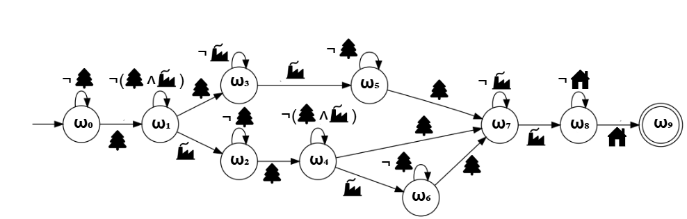
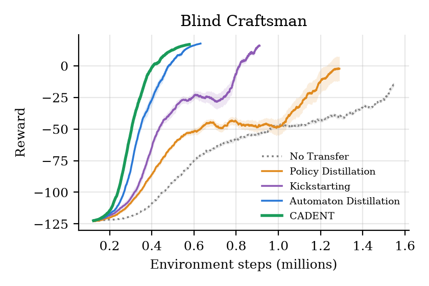
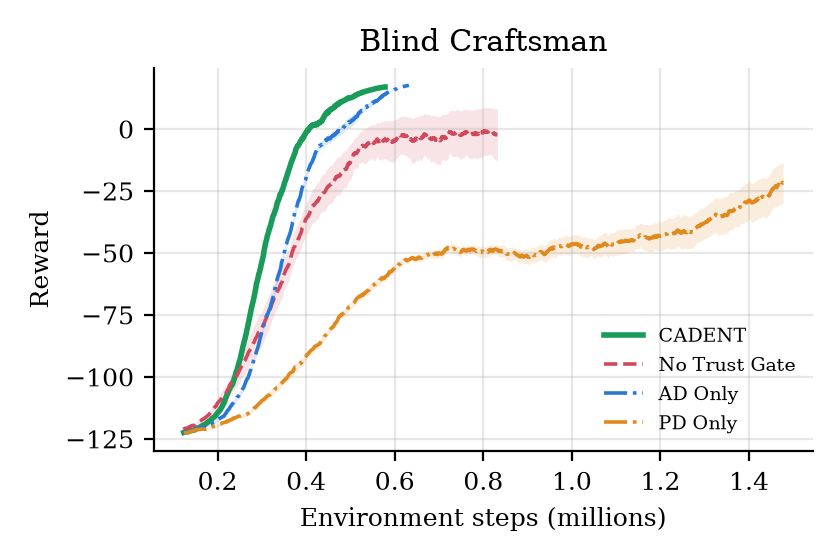

<div align="center">

# CADENT: Context-Aware Distillation with Experience-gated Transfer

**Transfer both what to achieve and how to act, and let the student decide when to trust the teacher.**


[](https://www.python.org/)
[](LICENSE)
[](https://github.com/mahyar333/CADENT/actions/workflows/tests.yml)

Implementation of<br>
**CADENT: Gated Hybrid Distillation for Sample-Efficient Transfer in Reinforcement Learning**<br>
Mahyar Alinejad, Yue Wang, George Atia · *AISTATS 2026*

</div>

---

## Overview

Transfer learning can cut the sample cost of reinforcement learning, but existing methods transfer only one
kind of knowledge:

- **Policy distillation** gives *tactical* advice ("how should I act now?") but no long-term plan.
- **Automaton distillation** gives *strategic* guidance ("which sub-goal comes next?") but no fine-grained action advice.

Both treat the teacher as always right, even when the target task differs from the source task.

**CADENT** combines the two and adds an **experience-gated trust mechanism** that decides, for every
state-action pair, how much the student relies on the teacher versus on its own experience:

1. **Strategic guidance.** The teacher's Q-values are distilled into values of *automaton transitions*,
   $Q_{AD}(q, q')$, the average teacher value of the state-action pairs that move the task automaton from $q$ to $q'$.
2. **Tactical guidance.** The teacher's phase-conditioned policy $\pi_T(a \mid q)$ pulls the student's policy
   towards the teacher's: $g_{PD}(s,a) = \lambda_{PD}\,(\pi_T(a \mid q) - \pi_S(a \mid s))$.
3. **Experience-gated trust.** A per-state-action volatility tracker of the student's TD errors,
   $V(s,a) \leftarrow (1-\eta)V(s,a) + \eta\,|\delta|$, sets the trust
   $\omega(s,a) = \sigma(-k\,(V(s,a) - \theta))$, and the update arbitrates between student and teacher:

$$\Delta Q(s,a) = \omega(s,a)\,\delta_{\text{student}} + \bigl(1 - \omega(s,a)\bigr)\,\bigl[r_{AD} + g_{PD}(s,a)\bigr].$$

## Benchmark: Blind Craftsman

This repository demonstrates CADENT on **Blind Craftsman**, the paper's long-horizon benchmark and the
environment of its ablation study. The teacher learns a small **source** version of the task; the student
learns a larger **target** version with a different layout.

<table>
<tr>
<td width="55%">

| | Blind Craftsman |
|---|---|
| **Teacher / student** | 6×6 grid / 25×25 grid, different layouts |
| **Task** | collect wood (carry at most 2), craft 3 tools at the factory, return home |
| **Valid orders** | 1+1+1, 2+1, 1+2 (units of wood per factory visit) |
| **Actions** | 4 moves |
| **Reward** | sparse: task completion only, plus a step cost |

</td>
<td width="45%"><br><sub>Task automaton</sub></td>
</tr>
</table>

## Results

20 seeds per method (mean ± standard error). All methods share the same Q-learning settings and exploration
schedule; each method's own hyperparameters were tuned on separate tuning seeds.

<p align="center"></p>

| Method | Env. steps to threshold | Fewer steps than No Transfer | Runs reaching it | Final reward |
|---|:---:|:---:|:---:|:---:|
| No Transfer | not reached | | 0/20 | −20.1 ± 1.4 |
| Policy Distillation | 1,246k ± 73k | 19% | 17/20 | −2.6 ± 9.4 |
| Kickstarting | 822k ± 39k | 47% | 20/20 | 15.5 ± 0.4 |
| Automaton Distillation | 489k ± 19k | 68% | 20/20 | 17.5 ± 0.1 |
| **CADENT** | **429k ± 9k** | **72%** | **20/20** | 16.8 ± 0.1 |

*Threshold: the 50-episode average reward reaches 90% of the way from the initial to the best final reward.
Runs that never reach it are counted at their full budget.*

- **CADENT is the fastest method**: 12% fewer environment steps than Automaton Distillation (p = 0.01),
  48% fewer than Kickstarting, and 72% fewer than learning from scratch, which never reaches the threshold.
- The transfer methods rank as in the paper: CADENT > Automaton Distillation > Kickstarting > Policy
  Distillation > No Transfer.
- Policy-level transfer alone is unstable here (3 of 20 Policy Distillation runs never reach the threshold):
  tactical advice without the task structure is not enough for a long sub-goal sequence.

### Ablation (Blind Craftsman)

<p align="center"></p>

| Variant | Env. steps to threshold | Runs reaching it | Final reward |
|---|:---:|:---:|:---:|
| **CADENT (full)** | **429k ± 9k** | **20/20** | 16.8 ± 0.1 |
| No Trust Gate (ω = 0.5 everywhere) | 719k ± 124k | 16/20 | −1.7 ± 10.1 |
| AD Only (no tactical guidance) | 497k ± 16k | 20/20 | 17.5 ± 0.0 |
| PD Only (no strategic guidance) | 1,471k ± 51k | 6/20 | −24.6 ± 8.0 |

Every component contributes: removing the trust gate makes learning slower and unstable, and neither strategic
nor tactical guidance alone matches their combination.

> These results were produced with this open-source version of the implementation, which includes some
> modifications (see [Implementation notes](#implementation-notes)); every method uses the same environments,
> rewards and seeds. Exact numbers therefore differ from the paper's figures, but they confirm its main findings on
> this benchmark.

## Implementation notes

- **Environment** follows the paper's experiments. Rewards are *sparse* for every method: only task completion is
  rewarded (plus a step cost), so the sub-goal structure has to come from transfer rather than from the reward.
- **Teacher knowledge.** $Q_{AD}(q, q')$ averages the teacher's Q-values over the state-action pairs whose outcome
  changes the automaton state from $q$ to $q'$; $\pi_T(\cdot \mid q)$ is the softmax (temperature $\tau$) of the
  teacher's mean Q-values in automaton state $q$.
- **Strategic channel.** Besides the bonus $r_{AD}$ in the teacher term, the student's own error is computed
  towards a target blended with $Q_{AD}(q, q')$ (weight $\rho^{n(q,q')}$, decaying with experience). At full trust
  CADENT therefore reduces to Automaton Distillation, and the gate adds the tactical guidance on top.
  `strategic: reward` gives the update with the bonus only.
- **Baselines.** Automaton Distillation blends the TD target with the teacher's transition values
  (Singireddy et al., 2023); Policy Distillation adds $\beta(\pi_T - \pi_S)$ to the update (Rusu et al., 2016);
  Kickstarting uses the same term with one global weight annealed from 1.0 to 0.1 (Schmitt et al., 2018).
- **Tuning protocol.** All methods share the Q-learning step size, discount and exploration schedule. Each
  method's own parameters were searched on tuning seeds 100–102 with [`cadent/tune.py`](cadent/tune.py): the full
  grid for Automaton Distillation, 60 configurations each for Policy Distillation and Kickstarting, and additional
  rounds for CADENT's larger parameter space. The reported results use the disjoint evaluation seeds 0–19.

## Installation

```bash
git clone https://github.com/mahyar333/CADENT.git
cd CADENT
python -m venv .venv && source .venv/bin/activate
pip install -e ".[dev]"
```

## Usage

```bash
# all methods on one benchmark (results as JSON in results/<env>/<method>/)
python -m cadent.run --config configs/blind_craftsman.yaml

# selected methods and seeds
python -m cadent.run --config configs/blind_craftsman.yaml --methods cadent ad --seeds 0 1 2

# ablation variants of CADENT
python -m cadent.run --config configs/blind_craftsman.yaml --ablation

# figures and summary tables (assets/results/)
python -m cadent.plot --env blind_craftsman
python -m cadent.plot --env blind_craftsman --ablation

# hyperparameter search with an equal budget per method
python -m cadent.tune --config configs/blind_craftsman.yaml --methods cadent ad

# tests
pytest -q
```

The hyperparameters in [`configs/`](configs) are generic placeholders that run end to end but are not the tuned
values behind the reported results. Tuned configurations are available on request.

## Repository structure

```
cadent/
  automaton.py   task DFAs
  envs/          Blind Craftsman (teacher and student layouts)
  teacher.py     teacher Q-learning and knowledge distillation (Q_AD and pi_T)
  agents.py      CADENT, Automaton Distillation, Policy Distillation, Kickstarting, No Transfer
  run.py         experiments over methods and seeds
  tune.py        equal-budget hyperparameter search
  plot.py        figures and summary tables
configs/         experiment configuration
tests/           unit tests
```

## Citation

```bibtex
@inproceedings{alinejad2026cadent,
  title     = {{CADENT}: Gated Hybrid Distillation for Sample-Efficient Transfer in Reinforcement Learning},
  author    = {Alinejad, Mahyar and Wang, Yue and Atia, George},
  booktitle = {Proceedings of the 29th International Conference on Artificial Intelligence and Statistics (AISTATS)},
  year      = {2026}
}
```

## Acknowledgements

This work was supported by DARPA under Agreement No. HR0011-24-9-0427 and NSF under Award CCF-2106339.

## License

[MIT](LICENSE)
